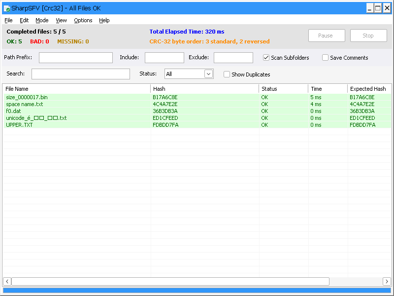
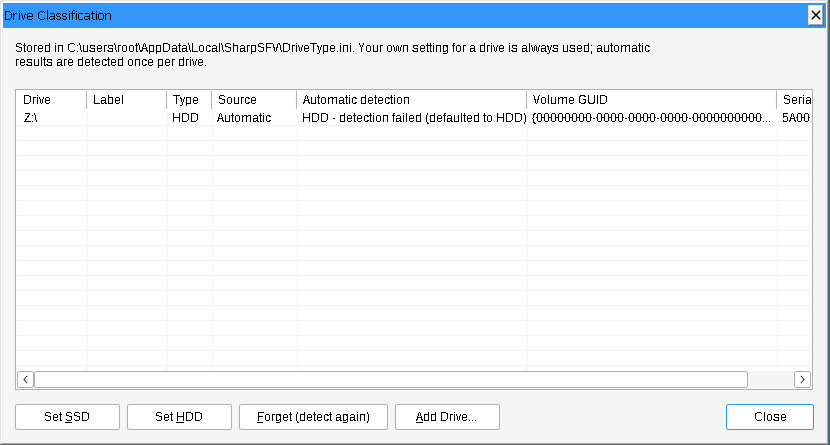

# SharpSFV — C++ port

A C++20 port of [SharpSFV](https://github.com/Wishwanderer/SharpSFV) (C# / .NET 10, by L33T).
It has three parts:

* **A core library** (`src/core/`, no UI code): the hashing engine, verification, reading and
  writing checksum files, settings, drive detection and the job queue.
* **The Windows program**, `SharpSFV.exe` (`src/gui/`): a native Win32 GUI covering everything
  the original window did. Its `-headless` mode runs `SharpSFV-cli.exe`.
* **A console program**, `SharpSFV-cli.exe` (`src/cli/`), which also builds on Linux.

Two features were added at the user's request:

* CRC-32 byte-order compatibility (QuickSFV-style and C# SharpSFV-style `.sfv` files).
* A per-drive SSD/HDD record, kept in AppData only with the user's consent.

Licensed under the **GNU GPL v3** like the original (see `LICENSE.txt`). The vendored xxHash in
`third_party/xxhash` is BSD-2-Clause (GPL-compatible) and keeps its own license file. Every source
file carries the original copyright line and a dated notice that it was modified:

* 2026-10-02: the port itself.
* 2026-10-03: the byte-order and drive-storage features, the GUI, and the size reductions.
* 2026-10-04: the lean rewrite (`lean/`), including its window; the command line creates a missing
  `SharpSFV.ini`.
* 2026-10-04: lean Phase 4: built with Clang + LLD (link-time optimization, identical code
  folding) for smaller programs; CRC-32 with PCLMULQDQ; a smaller icon file (same pixels).
* 2026-10-06: SharpSFV Lite (`lean/lite/`), a verify-only tool for Inno Setup installers.

## Build

**Windows, Visual Studio 2022** (no dependencies; MD5/SHA use Windows CNG, xxHash is vendored):

```bat
cmake -B build -G "Visual Studio 17 2022" -A x64
cmake --build build --config Release
build\Release\sharpsfv_tests.exe
```

This produces `build\Release\SharpSFV.exe` (GUI) and `SharpSFV-cli.exe`. Each is a single
self-contained executable with a static runtime; set `-DSHARPSFV_STATIC_RUNTIME=OFF` to use the
DLL runtime instead. Ship the two together: `SharpSFV.exe -headless` and "Install for Command
Line" both use `SharpSFV-cli.exe` from the same folder.

Build options (all `-D<name>=ON|OFF`):

| Option | Default | Effect |
| :--- | :--- | :--- |
| `SHARPSFV_OPTIMIZE_SIZE` | ON | Release builds optimise for size, except the hashing code (see [Executable size](#executable-size)) |
| `SHARPSFV_GUI_EMBED_HEADLESS` | OFF | Build the command-line mode into `SharpSFV.exe` as well (about 35 KB larger, no `SharpSFV-cli.exe` needed for `-headless`) |
| `SHARPSFV_STATIC_RUNTIME` | ON | Self-contained executables (no runtime DLLs) |
| `SHARPSFV_BUILD_TESTS` | ON | Unit tests and the oracle probe |

**Windows from Linux (MinGW-w64):**

```sh
cmake -B build-win -G Ninja -DCMAKE_TOOLCHAIN_FILE=cmake/mingw-w64-x86_64.cmake
cmake --build build-win
```

The toolchain file uses MinGW-w64's native `win32` thread model (GCC 13 or later). For an older
GCC, set the environment variable `SHARPSFV_MINGW_THREADS=posix`.

**Linux** (the CLI only, for development or as a portable tool; needs OpenSSL for MD5/SHA):

```sh
cmake -B build -G Ninja && cmake --build build && build/sharpsfv_tests
```

> The Windows binaries were built with MinGW-w64 (GCC 13) and tested under Wine 9. The code
> uses only the Windows SDK and standard C++20, but it has **not been compiled with MSVC**,
> so the first Visual Studio build may need small fixes.

## The GUI

Same layout, menus, shortcuts and behaviour as the original:

* **List:** virtual-mode list of files with OK/BAD/MISSING colours, column sorting, a
  search/status filter and a duplicate view.
* **Bars:** an advanced bar (path prefix, include/exclude patterns, subfolders, comments) and a
  comments bar that shows a checksum file's `;` comments.
* **Processing:** an Active Jobs panel for files over 50 MB, Pause/Stop, throughput and ETA, and
  progress on the taskbar button.
* **Job Queue mode:** each drop becomes a job with its own checksum file.
* **Explorer integration:** "SharpSFV: Create Checksum" for files and folders (multi-select is
  gathered into one file through the same mutex and named pipe as the original), a mini progress
  window, and `.sfv` file association.
* **Context menu:** open the containing folder, copy, rename, delete or remove entries.
* **Tools:** compare a file with a hash on the clipboard; move or rename bad files; generate
  `.bat` scripts that delete bad files or copy/delete duplicates.
* **Help:** disk debug info, reset to defaults, credits.
* **Display:** per-monitor DPI aware, with Common Controls v6 visual styles.



The two added features in the GUI:

* **Options › CRC-32 Byte Order (SFV):** chooses Standard (QuickSFV) or Reversed (C# SharpSFV)
  for new files. Verification always accepts both orders:
  * the stats bar reports how many entries used each order;
  * the Hash column shows each CRC in the order it matched;
  * "Compare with Clipboard" accepts both orders too.
* **Options › Local Data Storage…** gives or withdraws consent. The same consent box (default
  answer **No**) appears once, on the first normal start.
* **Options › Processing Mode › Drive Classification…** lists the recorded drives. For the
  selected drive you can choose Set SSD, Set HDD or Forget (detect again). "Add Drive…" records
  a drive that was never used.
* **Drive mode in the title bar:** while files are processed, the title shows the mode used,
  `[HDD/Seq]` or `[SSD/Par]`. If detection failed, a warning in the stats bar points to the
  override.
* **Help › View current Disk Data** shows which rule decided the mode and what is stored for the
  drive.



`SharpSFV.exe -headless …` keeps the original's command lines working. It runs
`SharpSFV-cli.exe` from the same folder with the same arguments, console and exit code. If
`SharpSFV-cli.exe` is missing, it says so and exits with code 2.

Like any GUI program, an interactive Command Prompt does not wait for `SharpSFV.exe` to finish,
and that was also true of the original. In a script, call `SharpSFV-cli` directly, or use
`start /wait SharpSFV -headless …`.

## Command line

```text
SharpSFV-cli <checksum file>                 Verify (.sfv .md5 .sha1 .sha256 .xxh3 .txt ...)
SharpSFV-cli <files/folders...>              Hash and print a summary
SharpSFV-cli -create <files/folders...>      Hash and save checksums
  -out <file>          where to save (default: <common folder>\checksums.<ext>);
                       its extension picks the algorithm unless -algo is given
  -algo <name>         xxh3 | crc32 | md5 | sha1 | sha256  (default: DefaultAlgo in SharpSFV.ini)
  -mode <mode>         auto | hdd | ssd, this run only      (default: ProcessingMode in SharpSFV.ini)
  -crc-order <order>   standard | reversed, for CRC-32 values written to .sfv files
                       (default: Crc32ByteOrder in SharpSFV.ini = standard)

Drives and local data storage:
  -datastorage [status|allow|deny|ask]   permission to keep DriveType.ini in %LOCALAPPDATA%\SharpSFV
                                         (ask = the consent message box; deny deletes the file)
  -drives                                list the drives recorded in DriveType.ini
  -drive-status <path>                   how that path's drive is identified and classified
  -drive-set <path> hdd|ssd|auto         your setting for that drive (auto = detect it again)

Exit codes: 0 all OK, 1 bad/missing/unreadable files, 2 error, 3 cancelled (Ctrl+C)
```

`-headless` is accepted and ignored by `SharpSFV-cli`, so the original's command lines keep
working.

Settings come from `SharpSFV.ini` next to the executable. If the file does not exist, the
command line creates it with the default settings on its first run (since 2026-10-04), so
there is always a file to edit; an existing file is never rewritten by an ordinary run. The
format is the same as the original's, so the C# and C++ builds can share one file. Two keys were added at the end,
`Crc32ByteOrder` and `DataStorageConsent`. The C# build ignores them, but drops them when it
saves the file on exit.

## How the C# maps to C++

| C# | C++ |
| :--- | :--- |
| `IO/HashHelper.cs`, `System.IO.Hashing`, `System.Security.Cryptography` | `core/Hasher`: xxHash3-128 (vendored xxHash 0.8.3), slice-by-16 CRC-32, CNG (BCrypt) MD5/SHA |
| `Form1.Processing.cs` engine, `Channel<T>`, `ManualResetEventSlim`, `ProgressStream.cs` | `core/Engine`: producer thread, bounded queue (50,000), 1 or N consumers, `PauseGate`, large-file progress |
| `ThrottledUiUpdate` | `core/ProgressThrottle` (500 ms speed/ETA, 100 ms frame cap, drop-frame flag) |
| `ProcessJobQueue`, `CountFilesAsync` | `core/JobRunner`, `Engine::CountFiles` |
| `Models/FileStore.cs` (SoA) | `core/FileStore`: SoA in fixed 16K-item chunks, never reallocated, so readers on the UI thread stay safe |
| `Models/JobStore.cs`, `StringPool.cs` | `core/JobStore`, `core/StringPool` |
| `AppSettings.cs` | `core/AppSettings` (UI-free; `Save` takes a `SaveState`) |
| RunVerification parsing (2 regexes) | `core/ChecksumParser` (hand-written matchers, same captures) |
| `PerformSaveAction` / `SaveResultsToFile` / `SaveChecksumFileForJob` | `core/ChecksumWriter`: `WriteSaveAs` / `WriteCreateMode` / `WriteJobFile` |
| `IsFileAllowed` / `FitsMask` | `core/FileFilter` |
| `Utils/DriveDetector.cs`, `Interop/Win32Storage.cs` (IOCTLs) | `core/DriveDetector` (plus volume identification) |
| *(new)* | `core/DriveClassifier` (DriveType.ini, detect-once, user overrides), `core/DataStorage` (consent, AppData folder) |
| `System.IO.Path`, `Directory.EnumerateFiles` | `core/PathUtil`, `core/FileSystem` (Windows semantics, breadth-first order, skips hidden/system/reparse) |
| Form layout, menus, toolbar panels | `gui/MainWindow.cpp`, `gui/MainWindowMenus.cpp`, `gui/Panel` |
| ListView virtual mode, sorting, filtering, duplicates, colours | `gui/MainWindowList.cpp` + `core/ListModel` (sorting/filtering/duplicate logic, unit-tested) |
| Processing event handlers, mini mode | `gui/MainWindowRun.cpp` |
| Context menu, bad-file tools, script generation, clipboard compare | `gui/MainWindowActions.cpp` + `core/Scripts` |
| `Program.cs` mutex and named pipe | `gui/SingleInstance`, `gui/main.cpp` |
| Registry shell integration, self-installer | `gui/SystemIntegration` + `core/EnvPath` (PATH editing, unit-tested) |
| Input box, About, disk-info forms | `gui/Dialogs` + `res/SharpSFV.rc` |
| headless branches of `Program.cs` / `Form1` | `core/Headless`, `src/cli/main.cpp` |
| `Task`, `lock`, `ManualResetEventSlim` | `core/Threading` (native Windows threads, SRW locks and condition variables; the `std` types elsewhere) |

Threading in the GUI: the engine runs on one worker thread (plus its consumers). Workers never
touch a window. They store results in the `FileStore` and post a few coalesced `WM_APP_*`
notifications, and the UI thread reads the lock-free store when the list paints.

## How it was verified

* **Unit tests** (`tests/test_main.cpp`): 301 checks on Linux and 312 on the Windows build (run
  under Wine). They cover:
  * hash test vectors and streaming
  * parser edge cases and filters
  * Windows path semantics
  * settings round-trip
  * concurrency
  * the engine, verification and the job queue, including pause/cancel
  * both CRC-32 byte orders, including mixed files
  * consent gating, detect-once and per-drive overrides
  * VeraCrypt-style volume matching
  * eight writers updating DriveType.ini at once
  * the GUI's sorting, filtering and duplicate grouping, script generation and PATH editing
* **Against the original code** (`scripts/compare_with_oracle.sh`): `tools/oracle` is the
  original's parser, filters, INI loader, enumeration, relative-path logic and Save-As writer,
  copied out of the C# sources together with System.IO.Hashing 10.0.1. The corpus is generated:
  Unicode names, 0 B to 60 MB files, BOM/UTF-16 checksum files, a 400-line parser stress file,
  1,200 filter cases and odd INI files. All 49 comparisons match:
  * Checksum files written in reversed order are **byte-identical** to the C# output.
  * The C# code accepts the port's standard-order `.sfv` files, and the port accepts the C# files.
  * An independent checker built on Python's zlib (`scripts/zlib_sfv_check.py`, the QuickSFV
    convention) accepts the port's standard-order files and rejects reversed ones.
* **GUI, end to end under Wine** (driven with xdotool, checked from screenshots and the files and
  registry keys written):
  * first-start consent box
  * creation and verification, including the mixed-order `.sfv`
  * filters and the duplicate view
  * the Active Jobs panel on 24 files of 700 MB
  * job queue
  * Explorer mini mode with three simultaneous `-create` launches gathered into one file
  * Save As
  * rename, delete and remove
  * move and rename bad files
  * both scripts
  * clipboard compare in both byte orders
  * the Drive Classification dialog
  * shell registration and removal
  * Install and Uninstall for Command Line (PATH, then `SharpSFV-cli` run from a new prompt)

  The resulting checksum files were re-checked with zlib.
* **ThreadSanitizer, AddressSanitizer and UBSan:** clean on the tests and on a 3,000-file
  parallel CLI run with live throughput display and cancellation.
* **Windows-only behaviour.** Wine accepts some things that Windows rejects. The first GUI build
  showed a blank grey window on Windows 11 for exactly this reason. After that report, the GUI
  code was reviewed specifically for such differences, and these were fixed:
  * **Layout:** the window layout moved controls of different parent windows in one
    `DeferWindowPos` batch, which Windows discards entirely. This caused the blank window.
  * **Display scaling:**
    * At 125–200%, the window opened smaller than its own minimum size; it is now scaled and
      kept on screen.
    * Old fonts were deleted before controls had switched to the new ones.
    * The Active Jobs column widths were not scaled.
  * **Comments box:** pressing Esc in it would have destroyed the comments bar, and Tab could not
    leave it.
  * **Explorer mini mode:** the pipe listener could, in a narrow timing window, keep the process
    alive after the mini window closed.
  * **Progress bar:** the themed bar animates, so the final position of a run might not be drawn.

```sh
cd tools/oracle && dotnet build -c Release && cd ../..
scripts/compare_with_oracle.sh build/sharpsfv_probe dotnet tools/oracle/bin/Release/net8.0/oracle.dll
```

## Executable size

The first Stage 2 build was much larger than the original. Optimising for size brought both
programs well down, with no feature removed:

| | First Stage 2 build | Now |
| :--- | ---: | ---: |
| `SharpSFV.exe` (GUI) | 1,917,440 bytes (1.82 MB) | **387,584 bytes (379 KB)** |
| `SharpSFV-cli.exe` | 1,476,096 bytes (1.40 MB) | **254,976 bytes (249 KB)** |
| C# SharpSFV, for comparison | | 393 KB, plus the .NET 10 Desktop Runtime installed separately |

Sizes are as Windows Explorer shows them (KB = 1,024 bytes). The C++ executables need nothing
installed: no .NET runtime and no Visual C++ Redistributable. Most of the reduction came from not linking parts of the C++ runtime that a
Windows program does not need. The steps, measured on the GUI:

| Change | GUI size after |
| :--- | ---: |
| `-Os`, unused-code removal, symbols stripped | 1.36 MB |
| No `<iostream>` in the library (it linked the C++ locale system, about 700 KB) | 650 KB |
| No printf-style formatting, demangler or GUID table from the runtime | 563 KB |
| MinGW `win32` thread model instead of winpthreads | 543 KB |
| `-headless` runs `SharpSFV-cli.exe`; CRC tables built at start-up instead of stored | 497 KB |
| `-Oz`, no RTTI | 480 KB |
| Native Windows threads and locks (`core/Threading`) instead of `std::thread`, which brought in `std::system_error` and a second string implementation | 432 KB |
| No exception tables in code that never throws or catches | 407 KB |
| Smaller icon images (same sizes, colours reduced invisibly) | 391 KB |
| One shared copy of the sort routine instead of one per sort order | 383 KB |
| Icon PNGs written without row filters and compressed with zopfli (same pixels) | 379 KB |

The details:

* **Hashing speed is unchanged where it matters.** `Hasher.cpp` (CRC-32, xxHash3) is still
  compiled for speed (`-O2`/`/O2`). In-memory throughput was 2.7 GB/s for CRC-32 and about
  6 GB/s for xxHash3, faster than the disks being read.
* **Exceptions:** `-fno-exceptions` is used only in files that neither throw nor catch. An
  out-of-memory error still reaches the same handler as before. Destructors along the way are
  skipped, which does not matter when the program is about to report a fatal error.
* **libstdc++ replacements** (`src/shared/RuntimeTrim.cpp`, linked into the two programs only):
  * The internal container-error helpers now throw a plain `std::exception` carrying the same
    message.
  * The default terminate handler, which printed the demangled exception type before aborting,
    now just aborts; a GUI program has no console to print to.

  If a future GCC needs a helper that is not replaced, the link fails loudly rather than
  misbehaving.
* **MinGW only:** these runtime-trimming steps apply to GCC/Clang builds. A Visual Studio build
  uses `/O1 /Gy /Gw /GR- /OPT:REF /OPT:ICF`, with `/O2` for the hashing code.
* **Going further** would need one of two things, and neither is used:
  * the shared Visual C++ runtime DLLs (`-DSHARPSFV_STATIC_RUNTIME=OFF` with Visual Studio),
    which brings back an install requirement, as .NET has;
  * an executable packer such as UPX, which antivirus products often flag.
* **The lean rewrite** (`lean/`, started 2026-10-04) takes a third route: no C++ standard library
  and no C runtime start-up code. Its programs do everything the standard ones do and produce
  the same files and messages:
  * `SharpSFV.exe` (the window, with `-headless` built in) is 231,936 bytes (227 KB);
  * `SharpSFV-cli.exe` is 106,496 bytes (104 KB).

  These sizes come from the Clang + LLD build (`cmake/clang-mingw-x86_64.cmake`). It also hashes
  CRC-32 more than twice as fast as before, using the processor's PCLMULQDQ instruction.
  `lean/README.md` also gives sizes inside compressed archives, and the build options that
  make the archive smallest.
* **SharpSFV Lite** (`lean/lite/`, 2026-10-06) is a 58,880-byte, verify-only tool for Inno
  Setup installers. It reports through a status file and a log, and takes Pause and Stop through
  named events. See `lean/lite/README.md`.

  See `lean/README.md`.

## CRC-32 byte order

There are two ways to write a CRC-32 as eight hex digits. For the test string "123456789":

| Order | Written as | Used by |
| :--- | :--- | :--- |
| **Standard** (most significant byte first) | `CBF43926` | QuickSFV, RapidCRC, 7-Zip, cksfv, TeraCopy: the SFV convention |
| **Reversed** (least significant byte first) | `2639F4CB` | the C# SharpSFV (.NET's `Crc32.GetCurrentHash()` is little-endian) |

* **Verifying** checks every CRC-32 in both orders, so `.sfv` files from either kind of tool
  verify, including files that mix the two. The summary reports how many entries used each
  order, and the GUI shows each file's CRC in the order it matched. Accepting both orders makes a
  false match twice as likely: 2 in 4.3 billion instead of 1.
* **Creating** writes the order chosen in Options (`Crc32ByteOrder` in `SharpSFV.ini`), or set by
  `-crc-order` for one run. The default is **Standard**, so new files open correctly in QuickSFV
  and every other SFV tool. Choose Reversed to produce files identical to the C# SharpSFV's.
* **Re-saving:** "Save As" after verifying a mixed file writes every entry in the chosen order.
  That is how to convert an old file: verify it, then save it again.

Internally a CRC-32 is always held in standard order. The byte order is applied only when a value
is compared (`CompareDigest`) or written (`FormatDigest`).

## Drive classification and local data storage

SharpSFV reads HDDs one file at a time and SSDs in parallel. Automatic detection fails on some
volumes, and then falls back to HDD. Encrypted volumes such as VeraCrypt are the main case: they
give no seek-penalty answer and do not map to a physical disk. The port can remember each
drive's classification and your own choice for it.

**Consent first.** Nothing is read from or written to `%LOCALAPPDATA%\SharpSFV` until the user
agrees in the consent message box:

* The box has Yes/No buttons, with **No** as the default.
* It names the exact file, what it records and how to withdraw.
* The decision is kept in `SharpSFV.ini` (`DataStorageConsent=Allowed|Declined`), so declining
  stores nothing in AppData.
* Withdrawing later deletes `DriveType.ini`. Use Options › Local Data Storage… or
  `-datastorage deny`.
* The local, not roaming, AppData folder is used, because volume GUIDs mean nothing on another PC.

A screenshot of the box from the test run under Wine is in `docs/consent-dialog-wine.png`.

**Which setting wins.** The first rule that applies decides:
1. `-mode hdd|ssd` (this run only)
2. Options › Processing Mode › HDD/SSD (`ProcessingMode` in `SharpSFV.ini`; all drives)
3. your setting for this drive (Drive Classification dialog or `-drive-set`; `Source=User`)
4. the drive's stored one-time detection (`Source=Auto`)
5. detect now, and with consent store the result, so each drive is detected only once

Rules 1 and 2 are the manual overrides, and they need no consent. Without consent, rule 5 runs
every time and nothing is stored.

**DriveType.ini** is human-readable and safe to edit:

```ini
[Volume{6f1d5d6a-0000-0000-0000-100000000000}/1A2B-3C4D]
VolumeGUID={6f1d5d6a-0000-0000-0000-100000000000}
SerialNumber=1A2B-3C4D
FileSystem=NTFS
Label=Vault
MountPoint=E:\
Type=SSD
Source=User
Detected=HDD
DetectionFailed=1
DetectedBy=detection failed (defaulted to HDD)
Recorded=2026-10-03 14:05
Changed=2026-10-03 14:07
```

**How a drive is recognised.** A volume is matched to its section by:
1. same volume GUID and same serial number, otherwise
2. same serial number and file system.

Rule 2 is there for encrypted volumes. For a VeraCrypt volume, the Windows mount manager's GUID
may be tied to the drive-letter slot rather than to the volume:

* two different containers mounted at `E:` would then share a GUID;
* one container mounted at `F:` would get a new GUID.

The volume serial number belongs to the file system inside the container and travels with it,
so your setting follows the container. Network shares are recorded under their `\\server\share`
root.

There is one caveat for rule 2: a cloned volume keeps its serial number. A clone therefore
inherits the original's entry until you set it (or delete the section).

**Not yet tested on a real VeraCrypt volume.** It was tested under Wine and with simulated volumes.
The Drive Classification dialog, Help › View current Disk Data and `SharpSFV-cli -drive-status E:\`
show exactly which GUID, serial and detection path were used, so it is easy to check on a real
system.

## Deviations from the original

Everything not listed here behaves as in the C# version. These changes fix defects, or apply to
features the original did not have.

**Engine and files**

1. **HDD/SSD auto-detection actually works.** The original read a "rotation rate" at offset 36
   of `STORAGE_DEVICE_DESCRIPTOR`.
   * That structure has no such field. The offset lands in the vendor/model string area, so
     almost every drive was classed as an HDD and processed with one thread. The bogus check is
     gone.
   * A drive reporting "no seek penalty" (the documented Windows SSD signal) now counts as an
     SSD instead of falling through to a name guess.
   * The name guess's "Samsung" check, which could never match, is fixed.

   Users who saw "HDD Mode" on an NVMe drive now get parallel processing.
2. **Headless mode**
   * `-create` with `-headless` hashes and writes a file. In the original, `-create` always opened the
     Explorer mini-dialog, and plain headless creation never saved anything.
   * New `-out`, `-algo` and `-mode` options.
   * The default algorithm comes from `SharpSFV.ini` (the original always used xxHash3 headless).
   * Meaningful exit codes; the original always returned 0.
   * Missing input paths are reported as errors.
   * The checksum file being written is never hashed into itself.
   * Verification progress shows `n/total`; the original printed `n/-1 (0.0%)`.
3. **Unreadable files during creation count as BAD** (GUI and headless). The original showed them
   under MISSING and reported OK = total.
4. **Relative paths:**
   * A base folder that is only a text prefix of a path ("C:\Foo" vs "C:\FooBar\x") no longer
     produces a wrong relative path.
   * UNC paths keep their leading `\\` when computing the common base folder or when inputs share no common folder.
   * In Explorer "Create Checksum", paths are written relative to the folder where you save the
     file. The original wrote them relative to the selection's common folder, so a file saved
     anywhere else listed every entry as missing. When saved in the suggested folder, the output
     is unchanged.
   * Normal drive-letter paths are unaffected; byte-identical output is verified above.
5. **Job queue:**
   * Job IDs no longer repeat after "Clear Completed Jobs". Repeated IDs could overwrite an earlier
     job's `<id>.<name>.ext` file.
   * Clearing completed jobs while one runs can no longer redirect its progress to another row.
   * "Clear Completed Jobs" has a menu item (Mode menu); the original had the code but no way to
     reach it.
6. **Stop** cancels the engine cleanly; the original restarted the whole application.
   * A file interrupted mid-read stays "Queued" instead of being marked ERROR.
   * Large files in progress stop immediately.
   * Cancelling while a job is still counting files also works.
7. Out-of-range numeric enum values in the INI (e.g. `DefaultAlgo=9`) are ignored instead of
   producing an undefined algorithm.
8. **New `.sfv` files use the standard CRC-32 byte order by default** (see above). The C# build
   wrote reversed; choose Reversed to keep that.
9. **Per-drive classification** (DriveType.ini, with consent) is new. If consent is never given,
   drives are detected on every run as before.

**GUI**

10. **No silent self-installer.** On every start, the original copied itself to
    `%LOCALAPPDATA%\SharpSFV` and added that folder to the user's PATH, without asking.
    * This is now **Options › System Integration › Install for Command Line…**, which asks first.
    * It copies `SharpSFV.exe`, `SharpSFV-cli.exe` and the current settings.
    * The PATH value keeps its registry type (`REG_EXPAND_SZ` entries such as `%USERPROFILE%\bin`
      stay expandable).
    * **Uninstall from Command Line…** reverses it and leaves `DriveType.ini` alone.
11. **Explorer "Create Checksum":**
    * A single selected item no longer waits for more items before the save dialog appears.
    * Creating a file no longer overwrites your settings. The original saved the hidden window's
      size and position and reset TimeTab and ColumnOrder.
    * The named pipe is scoped to the Windows session and refuses remote clients.
    * The second progress bar shows progress inside large files.
12. **Sorting:**
    * Sorting follows the column you click, also after columns are hidden or reordered.
    * The Time column sorts numerically (the original put "10 ms" before "9 ms").
    * The headers show the native sort arrows.
13. **Duplicate view** groups only files that have a hash. Missing and unreadable files have none,
    and the original listed them all as duplicates of each other.
14. **Status filter:** the "Waiting..." entry matches queued files. In the original it matched
    nothing.
15. **Generated `.bat` scripts:**
    * `%` in file names is escaped. Without this, `cmd` expands it as a variable and the script
      can delete the wrong file.
    * The banner's `->` no longer creates a stray file.
    * `chcp 65001` makes non-ASCII file names work.
16. **Busy list protection:**
    * Rename, delete, remove and the bad-file tools are disabled while files are being processed.
    * Removing many entries is a single pass instead of one pass per entry.
    * After removing entries or comparing with the clipboard, the OK/BAD/MISSING counters are
      recounted from the list.
17. **Help › Reset to Default Values** asks before deleting the settings and restarting.
18. **The name column** widens to fit long file names after a run; it never shrinks below the
    default width.
19. **The program icon** (`res/SharpSFV.ico`) is a new, original drawing, because the original
    icon file was not available. Replace that file with the original `.ico` and rebuild to
    restore it. Expect the GUI's size to change by the difference between the two files.
20. **`SharpSFV.exe -headless` runs `SharpSFV-cli.exe`** from the same folder instead of
    containing a second copy of the command-line mode. The arguments, output and exit code are
    the same. Build with `-DSHARPSFV_GUI_EMBED_HEADLESS=ON` to embed it again.

## Known limitations

* **Build and test coverage:**
  * Not yet compiled with MSVC (see Build).
  * The GUI was tested under Wine. On Windows 11, the user confirmed drive detection and
    checksum creation with the previous build; the fixes since then (see How it was verified)
    have not yet been checked on Windows.
  * Not yet tested on a real VeraCrypt volume.
* **Display under Wine:** CJK and emoji file names appear as boxes. This is a font limitation of
  the test environment, not of the program; the names are stored and written correctly.
* **List selection colours:** selected rows use the system highlight instead of the status
  colour. With the list unfocused, the selection is not shown (the ListView default, as in
  WinForms).
